# 🚀 Portfolio System

Este é o sistema por trás do meu portfólio pessoal. Não é apenas um site estático, mas uma aplicação distribuída moderna construída com foco em performance, escalabilidade e desacoplamento.

O projeto utiliza uma arquitetura de **Headless CMS**, onde o gerenciamento de conteúdo é separado da entrega dos dados e da interface do usuário.

## 🏗️ Arquitetura do Sistema

A arquitetura foi desenhada para ser resiliente e eficiente:

-   **Frontend**: Desenvolvido em **Next.js 15+** (App Router), focado em SEO e performance com SSR (Server Side Rendering).
-   **Core Backend (API)**: Uma API de alta performance escrita em **Go (Golang)** que serve os dados consumidos pelo frontend.
-   **CMS & Admin**: Utiliza **Laravel 12** com **Filament PHP 5** para um painel administrativo robusto e produtivo.
-   **Mensageria & Background Jobs**: Processamento assíncrono utilizando **Redis** e **Go Workers** (Asynq) para tarefas como envio de notificações (Discord/Telegram) e processamento de formulários.
-   **Banco de Dados**: **PostgreSQL 16** como storage principal para todos os dados relacionais.
-   **Infraestrutura**: Todo o ambiente é conteinerizado com **Docker** e orquestrado via **Docker Compose**, utilizando **Caddy** como proxy reverso.



## 🛠️ Tech Stack

### Frontend
- **Framework:** Next.js (React 19)
- **Styling:** Tailwind CSS 4
- **Linguagem:** TypeScript

### Backend (API & Worker)
- **Linguagem:** Go 1.24
- **Router:** Chi Router
- **ORM:** GORM
- **Task Queue:** Asynq (Redis based)

### CMS & Gestão
- **Framework:** Laravel 12
- **Admin Panel:** Filament PHP 5
- **Banco de Dados:** PostgreSQL 16
- **Cache/Queue Broker:** Redis

### DevOps & Infra
- **Containerização:** Docker & Docker Compose
- **Proxy/SSL:** Caddy
- **CI/CD:** GitHub Actions
- **Storage:** Oracle OCI (S3 Compatible)

## 🚀 Como Executar

Certifique-se de ter o **Docker** e o **Docker Compose** instalados em sua máquina.

1.  Clone o repositório:
    ```bash
    git clone https://github.com/ciroDourado/Portfolio.git
    cd Portfolio
    ```

2.  Suba os containers:
    ```bash
    docker-compose up -d
    ```

3.  O sistema estará disponível nos seguintes endereços:
    -   **Frontend**: [http://localhost:3000](http://localhost:3000)
    -   **API**: [http://localhost:8080](http://localhost:8080)
    -   **CMS (Admin)**: [http://localhost:8000](http://localhost:8000)

## 📁 Estrutura do Projeto

```text
.
├── applications/
│   ├── api/             # Backend principal em Go
│   ├── cms/             # Painel administrativo em Laravel/Filament
│   └── web/             # Frontend em Next.js
├── docker-compose.yaml  # Orquestração dos serviços
└── README.md            # Documentação do projeto
```

---
Desenvolvido por **Ciro Oliveira** - [LinkedIn](https://www.linkedin.com/in/cirodourado/)
